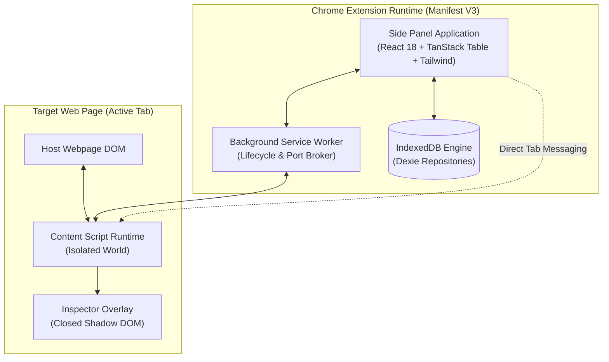
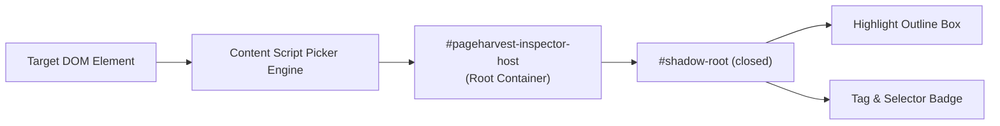
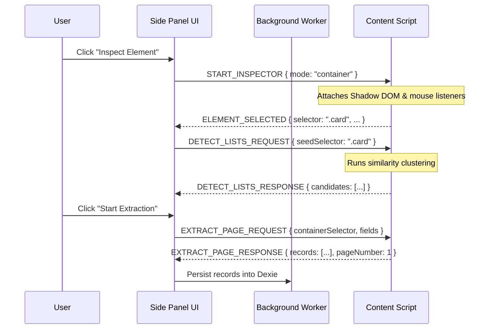

# PageHarvest System Architecture

## 1. Architectural Philosophy & Principles

PageHarvest is designed from the ground up as a **local-first, privacy-preserving, high-throughput Chrome extension (Manifest V3)** for structured web data harvesting.

### Core Principles
1. **Contract-Driven Development**: Every subsystem communicates exclusively via strictly validated TypeScript interfaces and Zod schemas located in `src/shared/contracts/`.
2. **Defensive DOM Isolation**: The host web page is an untrusted, hostile environment. All extension UI overlays must reside in closed Shadow DOM boundaries, with zero global stylesheet bleeding or JavaScript prototype contamination.
3. **Reactive Asynchrony & Decoupling**: Content scripts perform DOM observation and record extraction; the background service worker coordinates tab lifecycle and state synchronization; the side panel renders interactive controls and spreadsheet views.
4. **Resilient Local Persistence**: Extracted records are immediately buffered in Dexie (IndexedDB), guaranteeing zero data loss even if a user accidentally navigates away or closes a tab.

---

## 2. High-Level System Architecture Diagram



---

## 3. Subsystem Architectural Specifications

### 3.1 Browser Extension Entry Points
PageHarvest leverages modern WXT entry points configured for Chrome Manifest V3:

1. **Background Service Worker (`entrypoints/background.ts`)**:
   - Registered as `"background": { "service_worker": "..." }`.
   - Listens to `chrome.action.onClicked` and configures `chrome.sidePanel.setPanelBehavior({ openPanelOnActionClick: true })`.
   - Tracks tab changes (`tabs.onActivated`, `tabs.onUpdated`) to notify the Side Panel when the user navigates between sites.
   - Acts as a resilient fallback router if direct side panel to content script messaging encounters stale port disconnection.

2. **Content Script (`entrypoints/content.ts`)**:
   - Injected into all web pages via `"content_scripts": [{ "matches": ["<all_urls>"], "run_at": "document_idle" }]`.
   - Runs in the isolated JavaScript world. Host page scripts cannot inspect or tamper with extension variables.
   - Hosts the **DOM Inspector**, **Repeated Pattern Detector**, **Data Extractor**, and **Pagination Runner**.

3. **Side Panel Application (`entrypoints/sidepanel/index.html` & `main.tsx`)**:
   - Dedicated side panel rendered in Chrome's sidebar dock.
   - Houses the user workflow: Project setup, element picker controls, field configuration, pagination controls, live TanStack spreadsheet grid, and export dialogs.

---

### 3.2 Content Script Architecture & DOM Isolation
Content scripts must maintain complete styling and event isolation from the host page.



1. **Closed Shadow DOM**:
   The visual picker mounts an isolated host element (`div#pageharvest-inspector-host`) directly onto `document.documentElement`. All highlight rectangles, tooltips, and badges are injected into a closed shadow root:
   ```typescript
   const host = document.createElement('div');
   host.id = 'pageharvest-inspector-host';
   const shadow = host.attachShadow({ mode: 'closed' });
   // Injected overlay CSS does not touch page styles
   ```
2. **Event Interception**:
   - Uses capturing phase (`true`) on `mouseover`, `mouseout`, and `click` during inspection mode.
   - Calls `event.preventDefault()` and `event.stopPropagation()` to prevent triggering host links, modals, or tracking scripts while picking elements.

---

### 3.3 Side Panel Communication & Message Protocol
Communication is governed by the canonical discriminated union `BrowserMessage` in `src/shared/contracts/message.ts`.

#### Message Sequence Flow:


---

### 3.4 Repeated DOM Detection Pipeline
The detection engine identifies recurring collections (lists, grids, card columns, table rows) without remote ML models:

1. **Ancestor Traversal**: Starting from an inspect-selected node, the detector walks up the DOM hierarchy (`parentElement`).
2. **Structural Fingerprinting**: For each candidate parent, child elements are fingerprinted using:
   $$\text{Fingerprint} = \text{Tag} + \text{SortedClasses} + \text{ChildTagSequence}$$
3. **Similarity Clustering**:
   - Calculates structural match ratios among siblings.
   - If a container holds $N \ge 2$ items matching identical or near-identical tag structures, it is scored as a candidate.
4. **Confidence Scoring**:
   - Scored from 0.0 to 1.0 based on sibling count, presence of interactive elements (`a[href]`, `img`, prices), and depth.
5. **Selector Generation**: Produces resilient CSS selectors prioritizing IDs, BEM class patterns, and hierarchical tags (e.g. `main ul.product-grid > li.grid-item`).

---

### 3.5 Extraction Pipeline & Data Normalization
Once containers and fields are defined, the extraction pipeline processes each container:

1. **Relative Querying**: Queries field selectors scoped to each individual container element (`container.querySelector(field.selector)`).
2. **Extraction Strategies**:
   - `text`: Strips redundant whitespace and trims text content.
   - `attribute`: Extracts named attribute (e.g. `data-asin`, `data-sku`).
   - `href` / `src`: Automatically resolves relative URLs against `window.location.href` to ensure fully qualified URLs.
   - `number`: Regex parses currency symbols, commas, and extracts sanitized numeric floats.
   - `regex`: Executes user regex pattern against string and captures designated capture group.
3. **Transformations**: Applies pipeline filters (`trim`, `lowercase`, `uppercase`, `capitalize`).
4. **Deduplication Engine**:
   - Computes a deterministic content hash for each record:
     $$\text{Hash} = \text{SHA256}(\text{SortedValues}(\text{Record}))$$
   - Skips duplicate rows if encountered across multiple pages or infinite scrolls, updating the job's `duplicatesSkipped` counter.

---

### 3.6 Pagination & Navigation Pipeline
PageHarvest coordinates autonomous multi-page harvesting using three decoupled strategies:

1. **Next-Button Strategy (`next_button`)**:
   - Locates the pagination control via CSS selector.
   - Checks if the element is disabled, hidden, or absent.
   - Dispatches a synthetic click or navigates directly to `href`.
   - Waits for either `MutationObserver` (DOM re-render) or tab load completion.
2. **Infinite Scroll Strategy (`infinite_scroll`)**:
   - Executes programmatic window or container scrolling (`window.scrollTo({ top: document.body.scrollHeight, behavior: 'smooth' })`).
   - Listens to container DOM additions via `MutationObserver`.
   - Evaluates a 3-strike stall breaker: if 3 consecutive scrolls yield zero new matching container elements after `scrollDelayMs`, the runner terminates.
3. **Rate Limiting & Safety**:
   - Enforces configurable `delayMs` between requests (minimum 200ms, default 1500ms).
   - Enforces hard stop thresholds (`maxPages`, `scrollCount`).
   - AbortController signal provides instant, zero-latency user abort.

---

### 3.7 Persistence Layer (Dexie / IndexedDB)
All data persistence is handled by Dexie over IndexedDB in the extension context:

- **`projects`**: Saved extraction schemas, target URLs, and metadata.
- **`jobs`**: Historical and active execution logs, pages visited, error rates.
- **`records`**: Extracted rows indexed by `_id`, `_projectId`, `_jobId`, and `_page`.
- **`recipes`**: Reusable templates for instant extraction across identical site layouts.

---

### 3.8 Export Pipeline
The export subsystem serializes in-memory and persisted records into clean files:
- **CSV**: RFC 4180-compliant formatter with proper escaping of quotes (`"` $\to$ `""`), newlines, and UTF-8 BOM (`\uFEFF`) prepended for seamless Microsoft Excel rendering.
- **JSON / NDJSON**: Pretty-printed or line-delimited JSON streams.
- **Chunked Processing**: Data streams in chunks to ensure low memory usage even with 50,000+ records.
- **Download Broker**: Downloads initiate via `chrome.downloads.download` with fallback to `URL.createObjectURL(blob)` for cross-browser safety.

---

### 3.9 Error Handling & Fault Tolerance
Errors are typed using `ExtractionErrorCode` in `src/shared/contracts/error.ts`:
- **Recoverable Errors**: Stalled network requests, transient element timeouts $\to$ Retry with exponential backoff.
- **Non-Recoverable Errors**: Target tab closed, permission denied, invalid container selector $\to$ Stop job gracefully, preserve all collected records, emit diagnostic error message.

---

### 3.10 Extension Permission Model
Manifest V3 operates under a strict principle of least privilege:
- `activeTab`: Provides temporary script execution and DOM access only to the tab the user actively invokes.
- `sidePanel`: Grants access to mount the extension inside Chrome's side panel.
- `storage`: Grants access to `chrome.storage.local` for lightweight session cache.
- `scripting`: Allows dynamic script injection into the active tab.
- `downloads`: Allows direct triggering of file exports to the user's local disk.
- `<all_urls>` (Host Permissions): Enables content script extraction across target web domains.
