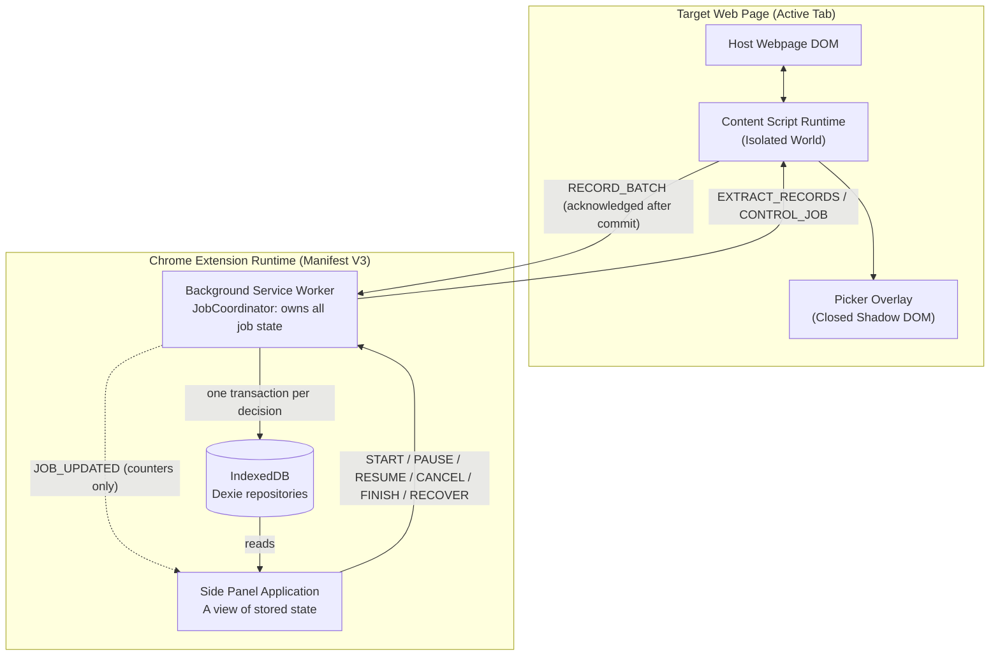
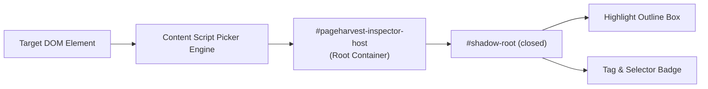
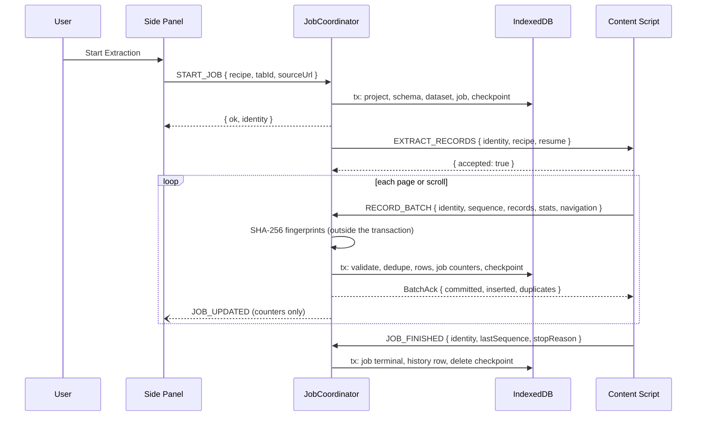
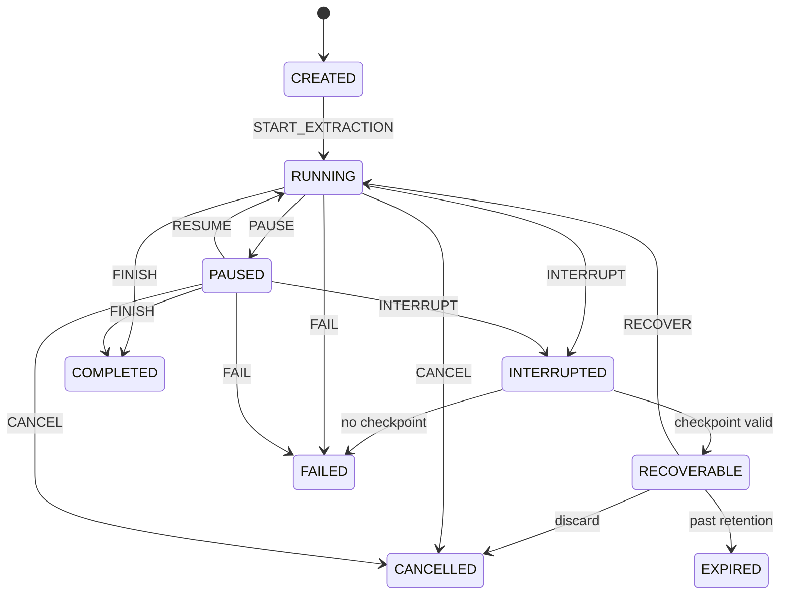

# PageHarvest System Architecture

## 1. Architectural Philosophy & Principles

PageHarvest is designed from the ground up as a **local-first, privacy-preserving, high-throughput Chrome extension (Manifest V3)** for structured web data harvesting.

### Core Principles
1. **Contract-Driven Development**: Every subsystem communicates exclusively via strictly validated TypeScript interfaces and Zod schemas located in `src/shared/contracts/`.
2. **Defensive DOM Isolation**: The host web page is an untrusted, hostile environment. All extension UI overlays must reside in closed Shadow DOM boundaries, with zero global stylesheet bleeding or JavaScript prototype contamination.
3. **Reactive Asynchrony & Decoupling**: Content scripts perform DOM observation and record extraction; the background service worker coordinates tab lifecycle and state synchronization; the side panel renders interactive controls and spreadsheet views.
4. **Durable, Background-Owned Persistence**: The background service worker is the only writer of extraction data. A batch is acknowledged only after its IndexedDB transaction commits, so an acknowledged record survives a closed panel, a closed tab, a worker restart and a browser restart.
5. **One Production Path**: Every module is reached from a real entry point. `tests/integration/production-wiring.test.ts` walks the import graph and fails if any module is reachable only from tests.

---

## 2. High-Level System Architecture Diagram



The side panel never writes extracted records. Closing it changes nothing about a running job.

---

## 3. Subsystem Architectural Specifications

### 3.1 Browser Extension Entry Points
PageHarvest leverages modern WXT entry points configured for Chrome Manifest V3:

1. **Background Service Worker (`entrypoints/background.ts`)**:
   - Registered as `"background": { "service_worker": "..." }`.
   - Configures `chrome.sidePanel.setPanelBehavior({ openPanelOnActionClick: true })`.
   - Hosts the `JobCoordinator` (`src/background/job-coordinator.ts`), the only owner of job state and the only writer of extraction data.
   - Holds nothing important in memory. It can be stopped between any two events; each handler reads what it needs from IndexedDB.
   - Watches tab closes and page loads to detect interrupted jobs, and reconciles on browser startup, extension install and side panel open.

2. **Content Script (`entrypoints/content.ts`)**:
   - Injected on demand via `chrome.scripting.executeScript` (runtime registration, ADR-037). No static `<all_urls>` entry.
   - Runs in the isolated JavaScript world. Host page scripts cannot inspect or tamper with extension variables.
   - Hosts the **DOM Inspector**, **Repeated Pattern Detector**, **Data Extractor**, and **Navigation Runner** (`runNavigationJob`).
   - Cannot reach the extension's IndexedDB (a content script's IndexedDB belongs to the page), which is why every record is sent to the background.

3. **Side Panel Application (`entrypoints/sidepanel/index.html` & `main.tsx`)**:
   - Dedicated side panel rendered in Chrome's sidebar dock.
   - Houses the user workflow: element picker controls, field configuration, pagination controls, progress, TanStack spreadsheet grid, export dialogs, and the library of projects, recipes, schemas and run history.
   - For extraction it is a view of stored state: it sends commands and reads results from IndexedDB, so it can open and close at any time.

---

### 3.2 Content Script Architecture & DOM Isolation
Content scripts must maintain complete styling and event isolation from the host page.



1. **Closed Shadow DOM**:
   The visual picker mounts an isolated host element (`div#pageharvest-inspector-host`) directly onto `document.documentElement`. All highlight rectangles, tooltips, and badges are injected into a closed shadow root:
   ```typescript
   const host = document.createElement('div');
   host.id = 'pageharvest-inspector-host';
   const shadow = host.attachShadow({ mode: 'closed' });
   // Injected overlay CSS does not touch page styles
   ```
2. **Event Interception**:
   - Uses capturing phase (`true`) on `mouseover`, `mouseout`, and `click` during inspection mode.
   - Calls `event.preventDefault()` and `event.stopPropagation()` to prevent triggering host links, modals, or tracking scripts while picking elements.

---

### 3.3 Message Protocol & Job Execution
There is one protocol: the discriminated union in `src/shared/contracts/message.ts`, validated with Zod at every boundary. `src/contracts/messages.ts` is only an import path for it.

#### Job execution flow:


#### Job identity
Every extraction message carries `{ jobId, projectId, datasetId, runId, generation }`. Batches also carry a `sequence`. The coordinator checks all of it inside the transaction that would write:

| Check | Rejection |
| :--- | :--- |
| The job exists | `unknown_job` |
| Project, dataset and run match the job | `identity_mismatch` |
| The job is CREATED, RUNNING or PAUSED | `job_not_active` |
| The generation matches | `stale_generation` |
| The message came from the job's tab | `wrong_tab` |
| `sequence <= lastSequence` | Acknowledged as `duplicate`, nothing is written |
| `sequence > lastSequence + 1` | `out_of_order` |

The generation is replaced when a job ends, is interrupted, or is resumed. Transactions on these tables run one at a time, so a batch racing a cancellation either committed first and is durable, or sees the cancelled job and is rejected.

Commands are accepted only from extension pages, and reports only from a tab's content script (`src/background/register-job-handlers.ts`).

#### Leaving a document
A navigation destroys the content script, so a job cannot wait across it. Before leaving a page the runner durably records where it is going (`awaitingNavigation`, `expectedUrl`). When the next document finishes loading (`tabs.onUpdated` "complete"), the coordinator injects the content script into it (ADR-037), validates the URL and sends `EXTRACT_RECORDS` again from the checkpoint. A document that already runs the script is not treated as new, so a second load event never sends the job twice. This is how both URL-template and ordinary next-link pagination work.

---

### 3.4 Repeated DOM Detection Pipeline
The detection engine identifies recurring collections (lists, grids, card columns, table rows) without remote ML models:

1. **Ancestor Traversal**: Starting from an inspect-selected node, the detector walks up the DOM hierarchy (`parentElement`).
2. **Structural Fingerprinting**: For each candidate parent, child elements are fingerprinted using:
   $$\text{Fingerprint} = \text{Tag} + \text{SortedClasses} + \text{ChildTagSequence}$$
3. **Similarity Clustering**:
   - Calculates structural match ratios among siblings.
   - If a container holds $N \ge 2$ items matching identical or near-identical tag structures, it is scored as a candidate.
4. **Confidence Scoring**:
   - Scored from 0.0 to 1.0 based on sibling count, presence of interactive elements (`a[href]`, `img`, prices), and depth.
5. **Selector Generation**: Produces resilient CSS selectors prioritizing IDs, BEM class patterns, and hierarchical tags (e.g. `main ul.product-grid > li.grid-item`).

---

### 3.5 Extraction Pipeline & Data Normalization
Once containers and fields are defined, the extraction pipeline processes each container:

1. **Relative Querying**: Queries field selectors scoped to each individual container element (`container.querySelector(field.selector)`).
2. **Extraction Strategies**:
   - `text`: Strips redundant whitespace and trims text content.
   - `attribute`: Extracts named attribute (e.g. `data-asin`, `data-sku`).
   - `href` / `src`: Automatically resolves relative URLs against `window.location.href` to ensure fully qualified URLs.
   - `number`: Regex parses currency symbols, commas, and extracts sanitized numeric floats.
   - `regex`: Executes user regex pattern against string and captures designated capture group.
3. **Transformations**: Applies pipeline filters (`trim`, `lowercase`, `uppercase`, `capitalize`).
4. **Record Preservation**:
   - A selected field with no value never removes a record. The record is kept with an empty value and counted as having missing fields.
   - Only a field the user explicitly marks "Skip rows where this column is empty" (`required: true`) excludes a record, and each exclusion is counted. Discovery never sets it.
   - Each job reports detected, kept, missing-field, filtered, failed and duplicate counts, on the progress view, the results, and the run history.
5. **Deduplication** (`src/core/extraction/record-identity.ts`):
   - Identity is the canonical record: sorted field names, values normalized by the documented rules (Unicode NFC, trimmed and collapsed whitespace, letter case kept, empty means no value, types kept), JSON-encoded so a value cannot imitate a separator. Metadata is excluded.
   - The stored fingerprint is SHA-256 of the canonical form. It only narrows down which rows to compare. A row is a duplicate only if its canonical form is equal, so a collision cannot remove a distinct record.
   - Fingerprints are computed before the transaction, because awaiting Web Crypto inside one would end it. The algorithm is recorded per job in `dedupeAlgorithm`.
   - Within a page run, an exact signature set removes repeats without hashing. A single-page job does not deduplicate, because each matched element is its own row.

---

### 3.6 Pagination & Navigation Pipeline
`src/core/navigation/runner.ts` runs a job on one document at a time, using limits read only from the recipe saved on the job.

1. **Next Button (`next_button`)**:
   - Finds the control from the configured selector or automatically, and treats a "Load more" control as appending to the same list.
   - Writes a checkpoint, then clicks. If the document is replaced, the job continues in the next one. If it is not, it continues in place.
   - Stops when the control is missing or disabled, at `maxPages`, on a repeated URL, or at a link to another website.
2. **Infinite Scroll (`infinite_scroll`)**:
   - Scrolls and waits for new elements. Elements unchanged since the last step are not re-reported as duplicates; a recycled virtualized row is re-read because memory is keyed by content as well as element.
   - Stops at `scrollCount`, or when steps produce nothing new.
   - After recovery the feed reloads from the top, so earlier scrolls are repeated before the job counts on. Known rows are deduplicated and do not end the job during this catch-up.
3. **URL Template (`url_template`)**:
   - `{page}` = startPage + (n - 1) x pageIncrement. `{offset}` = (startPage - 1) + (n - 1) x pageIncrement.
   - Stays on the origin the job started from. Validated in the UI, when the job starts, and before each navigation.
   - Stops at `maxPages`, on an empty page, or when a page adds nothing new. A page that loads with an unexpected URL fails the job. A page that never loads leaves it recoverable.
4. **Limits**:
   - `maxPages` limits pages, `scrollCount` limits scrolls, `maxRecords` limits rows. No limit affects another dimension, and progress is reported in the job's own unit (`pages`, `scrolls` or `single`).
   - Three consecutive batches with nothing new end a job, across documents (`EMPTY_STEP_CIRCUIT_BREAKER`).
   - `delayMs` is 200ms to 30s, default 1500ms. Pause holds at a gate before each step; cancel aborts delays immediately.

---

### 3.7 Persistence Layer (Dexie / IndexedDB)
All data is in `PageHarvestDB` in the extension's origin, reached through the repositories in `src/storage/repositories/`. The schema is at version 3; see [storage-schema.md](architecture/storage-schema.md) for tables and the production caller of each operation.

### 3.7.1 Job Lifecycle & Recovery
`src/core/state/extraction-machine.ts` is the single authority on transitions. The coordinator rebuilds a machine from the stored job for each event and writes the result in the same transaction, so an illegal transition cannot reach storage.



- CREATED and RUNNING are written by the same transaction that creates the job, and INTERRUPTED and RECOVERABLE by the same transaction that detects the interruption, so the intermediate states are never observed from storage.
- **Detecting interruption**: tab closed, page reloaded or left the site, expected page failed to load, browser restarted, extension reloaded, or (when the panel opens) the page no longer reports the job running. A service worker restart alone is not an interruption, because the page keeps working and the next message wakes the worker.
- **Checkpoints** hold where to continue. Records are in the `records` table and the configuration is on the job, so nothing is duplicated.
- **Every terminal state** deletes the checkpoint and writes the history row in the same transaction. Committed records are always kept; job metadata is kept for history.
- **Expiry**: recoverable sessions expire after `retentionDays` (default 30), checked each time the worker wakes.
- **Recovery** keeps the job's identity and sequence numbers, replaces the generation, and opens a new tab. Rows already stored are deduplicated, so it cannot create duplicate jobs or duplicate records. Two simultaneous resume requests cannot both succeed.

---

### 3.8 Export Pipeline
The export subsystem serializes in-memory and persisted records into clean files:
- **CSV**: RFC 4180-compliant formatter with proper escaping of quotes (`"` $\to$ `""`), newlines, and UTF-8 BOM (`\uFEFF`) prepended for seamless Microsoft Excel rendering.
- **JSON / NDJSON**: Pretty-printed or line-delimited JSON streams.
- **Formula protection**: Text that could execute as a spreadsheet formula (first visible character `=`, `+`, `-`, `@`, or a leading tab or carriage return) is written with a `' ` prefix. JavaScript numbers and booleans are never altered, and neither is signed numeric text (`-5`, `-12.50`, `+5`, `-$5.00`, `-15%`, `1e5`, `+1 (555) 123-4567`), because it contains nothing that can reference a cell or run a command.
- **Download Module**: `src/platform/downloads.ts` is the single download path. It reports success only after the browser accepts the download, and the export dialog stays open with the reason if it does not.

---

### 3.9 Error Handling & Fault Tolerance
Errors are typed using `ExtractionErrorCode` in `src/shared/contracts/error.ts`:
- **Recoverable Errors**: Stalled network requests, transient element timeouts $\to$ Retry with exponential backoff.
- **Non-Recoverable Errors**: Permission denied, invalid container selector, unexpected page $\to$ The job becomes FAILED, preserving all committed records, with the reason on the job, in run history, and on screen.
- **Interruptions**: Tab closed, page failed to load, browser restart $\to$ The job becomes RECOVERABLE and the user can resume or discard it.
- **Delivery failures**: A batch that cannot be stored is retried with the same sequence number. If it never succeeds, the job becomes RECOVERABLE. `src/core/resilience/error-reporter.ts` receives every workflow error.

---

### 3.10 Extension Permission Model
Manifest V3 operates under a strict principle of least privilege:
- `activeTab`: Exposes the URL and title of the tab the user opens PageHarvest on, and grants temporary injection access after the toolbar click.
- `sidePanel`: Grants access to mount the extension inside Chrome's side panel.
- `storage`: Grants access to `chrome.storage.local` for the first-run tour preference (ADR-032).
- `scripting`: Injects the content script on demand (ADR-037).
- `downloads`: Allows direct triggering of file exports to the user's local disk.
- `optional_host_permissions: ["http://*/*", "https://*/*"]`: Per-site grants requested one origin at a time. No `host_permissions`, no static `<all_urls>`, no `tabs` permission.

`scripting` is required for on-demand injection (ADR-037, supersedes ADR-034). `src/platform/permissions.ts` checks required permissions and per-site `contains` before a job starts; `tests/unit/manifest-assets.test.ts` asserts the built manifest (no `content_scripts` entries, no `host_permissions`, no `<all_urls>`, exact `optional_host_permissions`). What each permission is for, in the words the Chrome Web Store asks for, is in [STORE_LISTING.md](STORE_LISTING.md).
