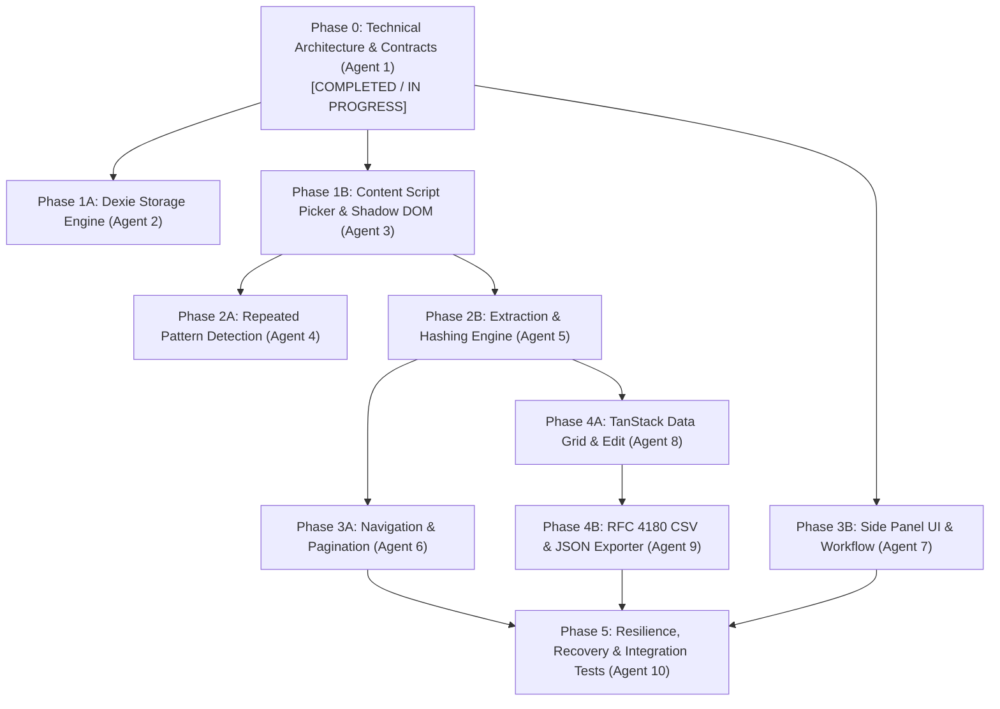

# PageHarvest Implementation Status & Technical Roadmap

> The roadmap below records the original work packages, and its "READY TO START/BLOCKED" labels are historical. Current status is in [CRITICAL_REMEDIATION_PLAN.md](CRITICAL_REMEDIATION_PLAN.md).

This document serves as the master tracking status for all features, modules, and work packages across the PageHarvest project.

## Current status: 2026-11-02

| Gate | Result | Evidence |
| --- | --- | --- |
| Unit and integration | PASS | `pnpm test`: 64 files, 668 tests |
| TypeScript | PASS | `pnpm typecheck` |
| ESLint | PASS | `pnpm lint` |
| Production build | PASS | `pnpm build` on the final code |
| ZIP package | NOT RE-RUN | Run `pnpm zip` before uploading |
| Browser extension | PASS | `pnpm test:e2e`: 33 of 33, twice on the final code |
| Public practice sites | PASS | Two sites, five scenarios; see the plan |
| Complete release gate as one run | NOT COMPLETED | Stopped by the system for low memory; each layer passed separately |
| Native toolbar and side panel | BLOCKED | No desktop automation tool; manual procedure not run |

Assessment: **FUNCTIONAL MVP**. See the plan for what a release candidate still needs.

---

## 1. Project Phase Overview

---

## 2. Detailed Work Package Status & Dependency Breakdown

### Phase 0: Architecture, Shared Contracts & Repository Foundation
- **Owner**: Agent 1 (Chief Architect)
- **Status**: **IN PROGRESS / NEAR COMPLETION**
- **Prerequisites**: None.
- **Tasks**:
  - [x] Repository inspection & clean structure setup.
  - [x] Comprehensive documentation (`AGENTS.md`, `ARCHITECTURE.md`, `DECISIONS.md`, `FILE_OWNERSHIP.md`, `PRODUCT_REQUIREMENTS.md`, `TEST_STRATEGY.md`, `TEST_MATRIX.md`, `TEST_RUNBOOK.md`, `INTEGRATION_GUIDE.md`).
  - [x] Canonical TypeScript contracts & Zod schemas (`ExtractionProject`, `ExtractionJob`, `ExtractionSchema`, `ExtractionField`, `ExtractionRecord`, `DetectedList`, `PaginationConfig`, `ExtractionProgress`, `ExtractionError`, `BrowserMessage`, `ExportConfig`).
  - [x] Test framework configuration (Vitest, JSDOM, fake-indexeddb).
  - [x] Approved Git commit baseline.

---

### Phase 1: Storage Layer & Visual Inspector Overlay (Parallel Tracks)
*These two tracks are completely decoupled and run in parallel once Phase 0 is merged.*

#### Track 1A: Local Storage Engine
- **Owner**: Agent 2 (Storage & Persistence)
- **Status**: **READY TO START**
- **Dependencies**: Phase 0 contracts.
- **Can Run in Parallel With**: Track 1B.
- **Tasks**:
  - [ ] Implement `PageHarvestDB` class extending `Dexie`.
  - [ ] Implement tables: `projects`, `jobs`, `records`, `recipes`, `history`.
  - [ ] Implement repository functions: CRUD for projects, bulk insert for records, atomic transaction commits.
  - [ ] Unit tests for Dexie storage operations with `fake-indexeddb`.

#### Track 1B: Visual Inspector & Closed Shadow DOM
- **Owner**: Agent 3 (DOM Inspector & Element Picker)
- **Status**: **READY TO START**
- **Dependencies**: Phase 0 contracts.
- **Can Run in Parallel With**: Track 1A.
- **Tasks**:
  - [ ] Create `InspectorOverlay` class attaching closed Shadow DOM to `document.documentElement`.
  - [ ] Implement hover outline box, dimension badge, and element breadcrumb path.
  - [ ] Implement event capturing for `mouseover`, `mouseout`, and `click` with `preventDefault()` / `stopPropagation()`.
  - [ ] Generate robust CSS and XPath selectors from selected DOM nodes.
  - [ ] Unit tests for selector generation and Shadow DOM isolation.

---

### Phase 2: Pattern Detection & Extraction Engine (Parallel Tracks)

#### Track 2A: Repeated Element & Pattern Detection
- **Owner**: Agent 4 (Pattern Detection Engine)
- **Status**: **BLOCKED (Awaiting Phase 1B)**
- **Dependencies**: Phase 1B (Inspector selector output).
- **Can Run in Parallel With**: Track 2B.
- **Tasks**:
  - [ ] Implement ancestor traversal and structural fingerprinting (`tag + classes + children`).
  - [ ] Implement sibling clustering and similarity scoring algorithm.
  - [ ] Implement auto-detection of common field candidates (`h1-h6` $\to$ title, `a[href]` $\to$ link, `img[src]` $\to$ image, price regex $\to$ price).
  - [ ] Unit tests with static HTML fixtures (e-commerce catalog, blog archive, table rows).

#### Track 2B: DOM Extraction & Data Normalization
- **Owner**: Agent 5 (Extraction & Normalization)
- **Status**: **BLOCKED (Awaiting Phase 1B)**
- **Dependencies**: Phase 1B.
- **Can Run in Parallel With**: Track 2A.
- **Tasks**:
  - [ ] Implement relative field extraction: `text`, `attribute`, `href`, `src`, `html`, `number`, `regex`.
  - [ ] Absolute URL resolution using `new URL(path, base).href`.
  - [ ] Implement post-extraction transformers (`trim`, `lowercase`, `uppercase`, `capitalize`).
  - [ ] Deterministic record content hashing (`SHA-256`) and duplicate row filtering.
  - [ ] Unit tests with HTML fixtures.

---

### Phase 3: Navigation, Pagination & Side Panel Shell (Parallel Tracks)

#### Track 3A: Navigation & Pagination Runner
- **Owner**: Agent 6 (Navigation & Pagination)
- **Status**: **BLOCKED (Awaiting Phase 2B)**
- **Dependencies**: Phase 2B.
- **Can Run in Parallel With**: Track 3B.
- **Tasks**:
  - [ ] Implement Next-button clicking runner with `MutationObserver` synchronization.
  - [ ] Implement Infinite Scroll controller with scroll stepping and stall detection.
  - [ ] Implement delay throttling (`delayMs`) and circuit breakers (`maxPages`, `scrollCount`, 0-records break).
  - [ ] Unit tests mocking DOM mutations and scroll events.

#### Track 3B: Side Panel UI & Tab Lifecycle
- **Owner**: Agent 7 (Side Panel UI & Tab Lifecycle)
- **Status**: **READY TO START (Can begin layout using mock state)**
- **Dependencies**: Phase 0 contracts.
- **Can Run in Parallel With**: Phase 1, Phase 2, Phase 3A.
- **Tasks**:
  - [ ] Build Side Panel React shell layout with header, active tab status, and workflow stepper.
  - [ ] Implement Tab connection status watcher (`chrome.tabs.onActivated`, `tabs.onUpdated`).
  - [ ] Build Field Configuration drawer / list editor.
  - [ ] Wire start/stop/pause controls with `BrowserMessage` dispatch.

---

### Phase 4: Data Grid & Export Engine (Parallel Tracks)

#### Track 4A: TanStack Data Grid & Inline Editing
- **Owner**: Agent 8 (Data Grid & Table UI)
- **Status**: **BLOCKED (Awaiting Phase 2B & Phase 3B)**
- **Dependencies**: Phase 2B contracts, Phase 3B UI shell.
- **Tasks**:
  - [ ] Implement TanStack Table v8 spreadsheet view.
  - [ ] Implement column sorting, filtering, and column show/hide toggles.
  - [ ] Implement inline cell editing and record deletion.
  - [ ] Live statistics header: records extracted, duplicates skipped, extraction duration.

#### Track 4B: RFC 4180 CSV & JSON Exporter
- **Owner**: Agent 9 (Export & Data Pipeline)
- **Status**: **BLOCKED (Awaiting Phase 4A)**
- **Dependencies**: Phase 0 contracts.
- **Tasks**:
  - [ ] Implement RFC 4180 CSV generator (escaping quotes, UTF-8 BOM `\uFEFF`).
  - [ ] Implement JSON and NDJSON streaming formatters.
  - [ ] Clipboard copy broker.
  - [ ] Trigger download via `chrome.downloads` or Blob object URLs.
  - [ ] Unit tests for CSV escaping with commas, quotes, newlines, and unicode.

---

### Phase 5: Resilience, Error Recovery & Integration Testing
- **Owner**: Agent 10 (Resilience, Error Recovery & Integration)
- **Status**: **BLOCKED (Awaiting all prior phases)**
- **Dependencies**: All subsystems.
- **Tasks**:
  - [ ] Crash recovery and partial extraction state persistence.
  - [ ] Exponential backoff retry for network/DOM timeouts.
  - [ ] Full end-to-end integration test suite simulating full scrape cycle.
  - [ ] Smoke tests across Chromium fixture environments.

---

## 3. Parallelism Matrix for Engineering Agents

| Agent | Current Status | Can Work Now? | Blocking For |
| :--- | :--- | :--- | :--- |
| **Agent 1 (Architect)** | Active | **YES** | All agents |
| **Agent 2 (Storage)** | Ready | **YES** | Phase 5 Integration |
| **Agent 3 (Picker)** | Ready | **YES** | Agent 4, Agent 5 |
| **Agent 4 (Detection)** | Blocked | No (Wait for Agent 3) | Agent 7 |
| **Agent 5 (Extraction)** | Blocked | No (Wait for Agent 3) | Agent 6, Agent 8 |
| **Agent 6 (Pagination)** | Blocked | No (Wait for Agent 5) | Agent 10 |
| **Agent 7 (Side Panel UI)**| Ready | **YES (UI scaffolding)** | Agent 8, Agent 10 |
| **Agent 8 (Data Grid)** | Blocked | No (Wait for Agent 7 & 5) | Agent 9 |
| **Agent 9 (Export)** | Blocked | No (Wait for Agent 8) | Agent 10 |
| **Agent 10 (Resilience)**| Blocked | No (Wait for Core modules) | Release gate |
