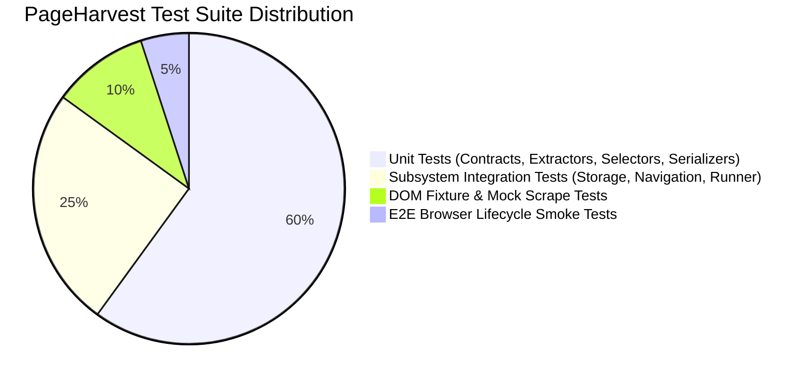

# PageHarvest Test Strategy & Testing Conventions

## 1. Quality Philosophy: Strict Test-Driven Development (TDD)

PageHarvest mandates a strict **Red-Green-Refactor TDD methodology** across all 10 specialized engineering roles. Every new feature, bugfix, or contract evolution must follow this sequence:

1. **RED**: Write a failing unit or integration test defining expected inputs, edge conditions, and outputs. Run the test to confirm it fails for the expected reason.
2. **GREEN**: Implement the minimal, robust production code necessary to turn the test green.
3. **REFACTOR**: Optimize performance, eliminate duplication, and polish TypeScript types without altering passing test behavior.

> [!IMPORTANT]
> **Zero Unrun Test Claims**: Agents must NEVER report or claim a test passed without executing `pnpm test` and observing the Vitest runner report 0 failures.

---

## 2. Test Pyramid & Scope



### 2.1 Unit Tests (`tests/unit/**` and `tests/contracts/**`)
- **Execution Time**: $< 500$ms per suite.
- **Environment**: Vitest with `jsdom` or Node.js.
- **Scope**:
  - Runtime validation of Zod contracts against valid & invalid payloads.
  - DOM selector generators and structural fingerprinting functions.
  - Value extractors (`text`, `attribute`, `href`, `src`, `number`, `regex`).
  - RFC 4180 CSV serialization, escaping, delimiter handling, and UTF-8 BOM injection.
  - Dexie database queries using in-memory `fake-indexeddb`.

### 2.2 Integration Tests (`tests/integration/**`)
- **Scope**:
  - Content script event listeners interacting with mock DOM structures.
  - Asynchronous message passing between Side Panel dispatcher and Content Script receiver.
  - Multi-page extraction runner with `MutationObserver` simulation.
  - Storage transactions involving project creation, batch record insertion, and atomic deletions.

### 2.3 End-to-End & Extension Lifecycle Smoke Tests (`tests/e2e/**`)
- **Scope**: Extension packaging verification, manifest syntax validation, and Chrome extension entrypoint loading.

---

## 3. Directory Layout & Fixture Organization

```text
tests/
├── contracts/                  # Canonical contract verification suites
│   └── canonical-contracts.spec.ts
├── unit/                       # Component-level unit tests
│   ├── contracts.test.ts       # Compatibility contract tests
│   ├── detection.test.ts       # Structural similarity & pattern detection
│   ├── dom.test.ts             # DOM tree traversal and normalization
│   ├── exporter.test.ts        # CSV / JSON / NDJSON serializers
│   ├── extractor.test.ts       # Field extractors & hashing
│   ├── navigation.test.ts      # Next button & infinite scroll runner
│   ├── selector.test.ts        # CSS & XPath selector generators
│   └── storage.test.ts         # Dexie repositories & transactions
├── integration/                # Cross-module workflow integration tests
│   ├── extraction-workflow.test.ts
│   └── messaging-lifecycle.test.ts
├── fixtures/                   # Static HTML and JSON datasets
│   ├── html/
│   │   ├── ecommerce-products.html
│   │   ├── news-articles.html
│   │   ├── tabular-data.html
│   │   └── infinite-scroll-mock.html
│   └── datasets/
│       └── sample-records.json
├── utils/                      # Test helper factories and DOM builders
│   ├── dom-factory.ts
│   └── test-factories.ts
└── setup.ts                    # Global Vitest setup (fake-indexeddb, Chrome mocks)
```

---

## 4. Test Naming & Coding Conventions

### 4.1 File Naming Standards
- Unit tests: `tests/unit/<feature>.test.ts`
- Contract tests: `tests/contracts/<contract>.spec.ts`
- Integration tests: `tests/integration/<flow>.test.ts`

### 4.2 Test Suite Structure (`describe` / `it`)
Use descriptive, behavioral sentences explaining the system's contract:
```typescript
describe('ExtractionField Extractor', () => {
  describe('when extractor is "number"', () => {
    it('strips currency symbols and parses float prices correctly', () => {
      // Arrange
      const element = createMockElement('<span class="price">$1,249.99</span>');
      // Act
      const value = extractFieldValue(element, { extractor: 'number', ... });
      // Assert
      expect(value).toBe(1249.99);
    });

    it('returns null when text contains no numeric characters', () => {
      // ...
    });
  });
});
```

---

## 5. Coverage Expectations & Quality Gates

| Subsystem | Target Line Coverage | Target Branch Coverage |
| :--- | :--- | :--- |
| `src/shared/contracts/**` | **100%** | **100%** |
| `src/core/extraction/**` | **90%+** | **85%+** |
| `src/core/detection/**` | **85%+** | **80%+** |
| `src/core/navigation/**` | **85%+** | **80%+** |
| `src/core/export/**` | **95%+** | **90%+** |
| `src/storage/**` | **90%+** | **85%+** |

---

## 6. Required Commands Runbook

| Command | Purpose |
| :--- | :--- |
| `pnpm test` | Run all unit, contract, and integration tests once. |
| `pnpm test:watch` | Run tests in interactive watch mode for active TDD cycle. |
| `pnpm test:coverage`| Generate v8 coverage report in terminal and `./coverage/`. |
| `pnpm typecheck` | Run TypeScript compiler strict type checking (`tsc --noEmit`). |
| `pnpm build` | Compile extension bundles for distribution. |
