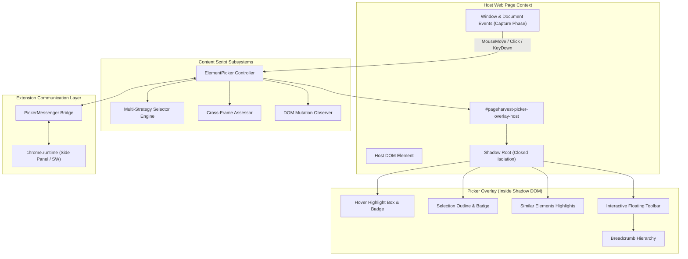

# Interactive Element Picker & Visual Overlay Architecture

## 1. Overview & Core Philosophy

The Interactive Element Picker is the user-facing bridge between the target web page and PageHarvest. It allows users to visually inspect and select elements on any webpage without contaminating the host DOM or being distorted by host CSS.

---

## 2. Key Architecture Pillars

### 2.1 Complete DOM & CSS Isolation (Shadow DOM)
- **Zero Style Contamination**: All overlay UI (hover box, selection box, similar element outlines, badges, floating toolbar, breadcrumb buttons) is rendered inside a `#pageharvest-picker-overlay-host` container with an isolated Shadow Root.
- **Hostile CSS Immunity**: Host styling resets (`* { display: none !important; all: unset !important; }`) cannot penetrate into the Shadow Root due to `:host { all: initial !important; }` and strictly scoped internal stylesheets.
- **Zero Host Mutation**: The picker never adds classes, inline styles, or attributes to host page DOM elements.

### 2.2 Stable Selector Generation Engine
The selector engine evaluates multiple orthogonal strategies and ranks candidates by specificity, uniqueness, and confidence:
1. **Test Attributes**: `[data-testid="..."]`, `[data-qa="..."]`, `[data-cy="..."]`.
2. **Stable Non-Dynamic IDs**: Validates that IDs do not contain framework auto-generation artifacts (e.g. rejecting `ember123`, `:r1:`, `sc-bdVaJa`, hashes).
3. **Semantic Classes**: Strips Tailwind/utility layout and spacing classes (`flex`, `p-4`, `text-sm`, `items-center`) and state classes (`active`, `hover`, `open`), retaining semantic domain classes (e.g. `.product-card`, `.price-tag`).
4. **Semantic Element Attributes**: `img[alt="..."]`, `input[name="..."]`, `a[aria-label="..."]`.
5. **Scoped Ancestor Hierarchies**: Ascends DOM tree to nearest stable parent anchor rather than building deep `:nth-child` chains.
6. **XPath Expressions**: Provides standard XPath representations as fallback.

### 2.3 Parent & Container Discovery
- When an inner element (e.g. a title `<h2>` or price ``) is selected, the breadcrumb trail displays the complete ancestor hierarchy up to `document.body`.
- Users can click any ancestor breadcrumb item or click the **"▲ Select Parent"** button on the toolbar to expand the selection to the parent card/container.

### 2.4 Similar Elements Highlighting
- Automatically identifies recurring pattern candidates matching the selected entity across the page.
- Renders dashed highlight boxes around all matching siblings and sister cards so users can visually verify repetition before confirming.

### 2.5 Dynamic DOM Mutation Adaptation
- `MutationObserver` watches for asynchronous DOM insertions, deletions, or attribute mutations.
- When new items appear (e.g., dynamically loaded content), match counts and similar element highlight boxes update automatically.
- If the selected element is disconnected from the DOM, the picker gracefully resets.

### 2.6 Cross-Frame Assessment
- Checks `window.self !== window.top` and frame hierarchy.
- Differentiates same-origin vs cross-origin iframes.
- Renders safety warnings in the toolbar when target elements belong to cross-origin subframes where Same-Origin Policy applies.

### 2.7 Complete Lifecycle & Event Cleanup
- All mouse, click, keydown, scroll, and resize listeners attach in the capture phase during inspection.
- When confirmed (`Confirm`), cancelled (`Cancel`, `Escape`), or stopped (`STOP_PICKER`):
  1. All global event listeners are detached.
  2. The `MutationObserver` is disconnected.
  3. The Shadow DOM host element is completely removed from the DOM.
  4. Subsequent clicks and hovers on the host website execute normally without interference.
