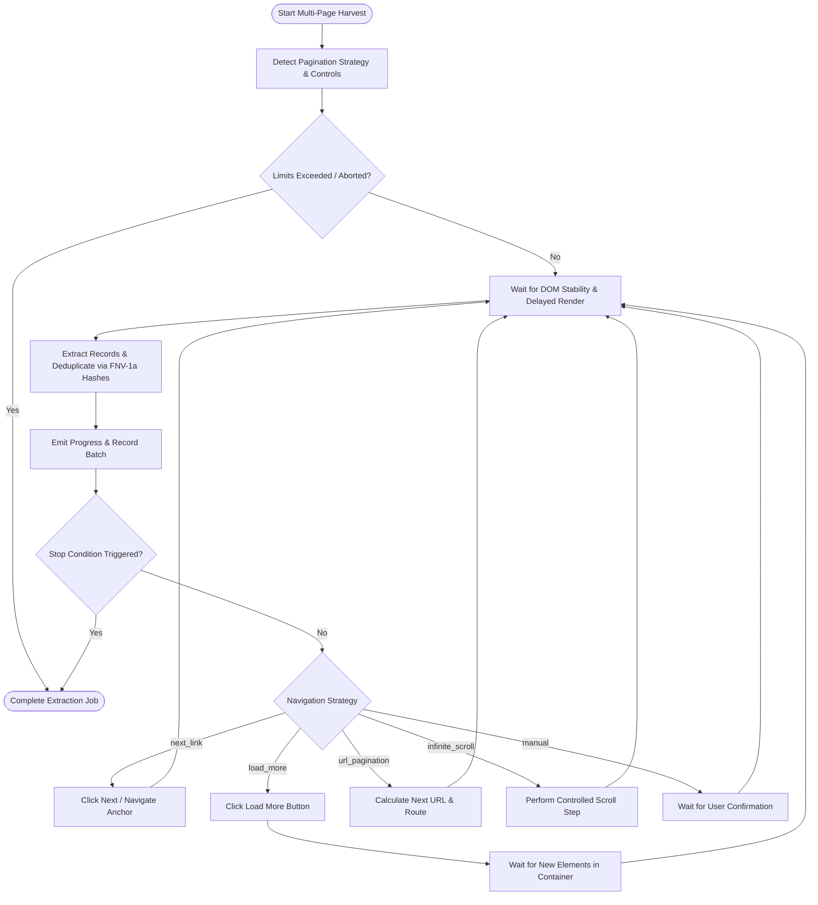

# Navigation, Pagination & Infinite Scroll Architecture

## Document handoff

A full navigation unloads the content script, so URL-template and ordinary next-link jobs continue across documents through the background:

1. The runner commits the page's batch together with its `navigation` state: the next page, whether a navigation is expected, and the expected URL. For a clicked link this is written just before the click, because the document may not survive it.
2. The new document's content script sends `CONTENT_READY` with its URL.
3. The `JobCoordinator` finds the job running in that tab, validates the URL against the checkpoint, and sends `EXTRACT_RECORDS` with the same generation and the next sequence number.

Rows live in the `records` table and are deduplicated when committed, so a checkpoint holds only where to continue. A URL-template page with the wrong URL fails the job. Any job whose tab leaves the site, or whose expected page never loads, becomes recoverable. See [ARCHITECTURE.md](../ARCHITECTURE.md), sections 3.3 and 3.7.1.

## 1. Supported Navigation Strategies

PageHarvest provides 5 deterministic navigation strategies for multi-page data harvesting:

1. **Next-Page Link (`next_link`)**:
   - Locates next page navigation elements via user-provided selector, `rel="next"`, `aria-label*="next"`, or textual indicators (`Next`, `Next Page`, `>`, `»`, `Older Posts`).
   - Checks control state (`disabled`, `aria-disabled="true"`, `.disabled` class) before interaction.
   - Dispatches simulated user clicks or coordinates page navigation.
   - Employs `MutationObserver` and quiet-window polling to ensure DOM stability before extraction.

2. **URL Pagination (`url_pagination`)**:
   - Automatically detects query parameter increments (e.g. `?page=1` -> `?page=2`, `?p=1`, `?offset=20`) and path patterns (e.g. `/page/1/`, `/p/1/`).
   - Supports explicit parametric URL templates (`https://example.com/items?page={page}` or `&offset={offset}`).
   - Normalizes visited URLs (stripping fragments, normalizing trailing slashes, sorting query parameters) to prevent cyclic navigation loops.

3. **Load More Button (`load_more`)**:
   - Detects dynamic append buttons (`Load More`, `Show More`, `View More`, `See More`).
   - Executes click actions and waits for container element count to increase (`waitForNewElements`).
   - Halts cleanly when the button becomes disabled, hidden, or removed from DOM.

4. **Infinite Scrolling (`infinite_scroll`)**:
   - Executes controlled window or container scroll steps (`performScrollStep`).
   - Monitors container child count and bottom boundaries.
   - Enforces strict safety limits on scroll counts (`maxScrolls`) to prevent runaway infinite loops.

5. **User-Confirmed Manual Page Navigation (`manual`)**:
   - Extracts current page data, pauses, and awaits explicit user confirmation (`manualStepTrigger`) before advancing.
   - Ideal for complex sites requiring CAPTCHAs, manual filters, or authenticated multi-step flows.

---

## 2. Safety Safeguards & Reliability Guardrails

- **Arbitrary Button Click Prevention (`isArbitraryNonPaginationButton`)**:
  - Strictly rejects non-pagination buttons (e.g. "Add to Cart", "Buy Now", "Submit", "Filter", "Search", "Delete", "Sign In", "Apply Coupon").
  - Interacts exclusively with verified pagination controls.

- **DOM Stability & Delayed Rendering Observer (`waitForDOMStability`)**:
  - Employs `MutationObserver` to monitor DOM changes on the target container.
  - Declares stability only after a mutation-free quiet period (configurable, default 150-250ms).
  - Handles client-side hydrated frameworks and asynchronous network delays (e.g. 1.5s delayed content).

- **Dynamic Element Count Observation (`waitForNewElements`)**:
  - Waits for child elements matching `containerSelector` to increase after "Load More" clicks or scroll events.
  - Times out gracefully if no new elements appear, triggering stop conditions.

- **Duplicate Record Prevention**:
  - Uses deterministic 32-bit FNV-1a hash indexing across all harvested records.
  - Tracks `seenHashes` persistently across pages to ensure zero duplicate records in the final dataset.

- **Circuit Breakers & Stop Conditions**:
  - `maxPages`: Strict ceiling capping page traversal (default 20).
  - `maxRecords`: Optional ceiling capping total records extracted.
  - `maxScrolls`: Caps scroll attempts (default 30).
  - `consecutiveEmptyLimit`: Halts if N consecutive pages yield 0 items (default 2).
  - `consecutiveDuplicateLimit`: Halts if N consecutive batches yield 100% duplicate records (default 2).
  - `repeated_url`: Halts immediately if the next URL has already been visited in the current session.

- **Resilience & State Recovery**:
  - Supports cooperative cancellation via standard `AbortSignal`.
  - Serializes `resumableState` (`currentPage`, `totalExtracted`, `duplicatesSkipped`, `seenHashes`, `visitedUrls`, `lastUrl`) to IndexedDB, enabling seamless job resumption after Service Worker suspension or restart.
  - Retries transient navigation errors with exponential backoff.

---

## 3. Data Flow Diagram

