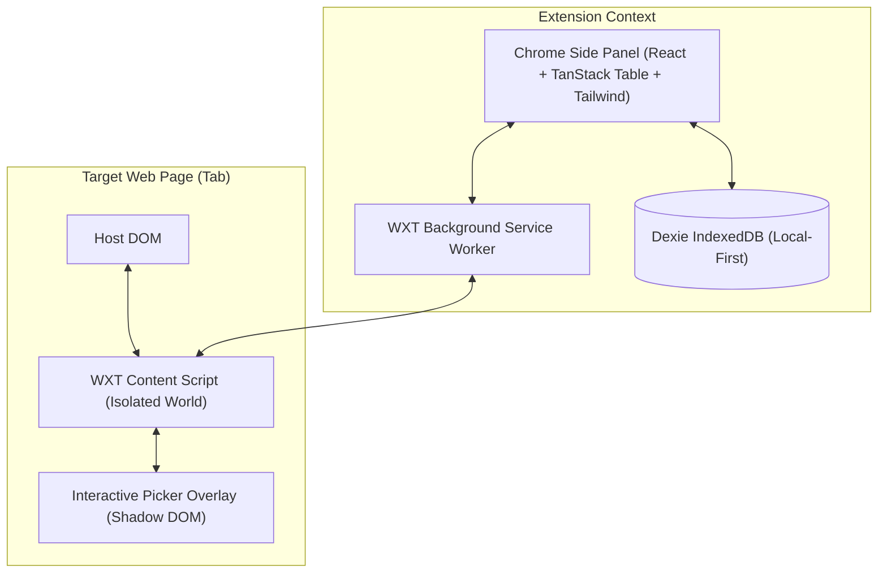

> Current as of the critical remediation. [ARCHITECTURE.md](../ARCHITECTURE.md) is the authoritative description: the background `JobCoordinator` owns all job state and writes all extraction data, and the side panel is a view of stored state.

# System Architecture Overview

## 1. High-Level Architecture

PageHarvest is a local-first, privacy-respecting Chrome extension built on Chrome Manifest V3 and the Side Panel API. It allows users to visually inspect websites, automatically identify repeated items (cards, table rows, list items), configure extraction fields, harvest data across multiple pages or infinite scrolls, clean and inspect data in a spreadsheet interface, and export to CSV or JSON.

## 2. Components Breakdown

### 2.1 Side Panel UI (`entrypoints/sidepanel/`)
- Embedded in Chrome's native side panel via `chrome.sidePanel`.
- Provides the user control center:
  1. Active tab indicator and connection status.
  2. Element detection & picker controls (Start Picker, Select Element, Auto-Detect).
  3. Field configuration panel (field name, type, selector, extractor).
  4. Multi-page navigation & pagination options (Next button selector, infinite scroll toggle, max pages, delay).
  5. Interactive data grid (TanStack Table) with sorting, filtering, editing, row deletion, and column management.
  6. Export controls (CSV, JSON, copy to clipboard).
  7. Extraction history and saved datasets management.

### 2.2 Content Script (`entrypoints/content.ts` + `src/content/`)
- Injected into web pages to inspect DOM, highlight elements, and extract structured records.
- Uses Shadow DOM for the visual picker highlight box and badge so host page CSS cannot break or distort picker styling.
- Listens for messages from the Side Panel / Background Service Worker.
- Executes DOM-level repeated element detection and field value extraction.

### 2.3 Background Service Worker (`entrypoints/background.ts`)
- Manages tab lifecycle, side panel opening on extension icon click (`chrome.sidePanel.setPanelBehavior({ openPanelOnActionClick: true })`).
- Routes messages between Side Panel and Content Script if direct tab messaging needs mediation.
- Tracks active tab transitions.

### 2.4 Local Storage Layer (`src/storage/`)
- Built on `Dexie` (IndexedDB wrapper).
- Stores datasets, schema configurations, extraction sessions, and history logs.
- Completely local — zero external requests.

## 3. Communication Protocol
Messages follow strict type contracts defined in `src/contracts/messages.ts` with Zod validation. Each message includes a unique `id`, a discriminated `type`, and a typed payload.
